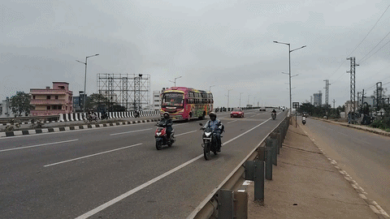

# Vehicle Detection and Speed Estimation using YOLOv8 and DeepSORT

## 🎬 Demo

## 📌 Description
This project detects and tracks vehicles from a traffic video using YOLOv8 and DeepSORT.

## ⚠️ Important Note
The speed shown in this project is **approximate/simulated**.

Real-world speed estimation requires:
- Camera calibration
- Distance measurement
- Pixel-to-meter conversion

## 🚀 Features
- Vehicle detection (car, bike, bus, van, autorickshaw)
- Multi-object tracking
- Approximate speed visualization
- Overspeed highlighting for cars

## 🛠️ Technologies Used
- Python
- OpenCV
- YOLOv8 (Ultralytics)
- DeepSORT

## ▶️ How to Run
1. Install dependencies:
   pip install -r requirements.txt

2. Run:
   python main.py

3. Output video:
   output/output.avi